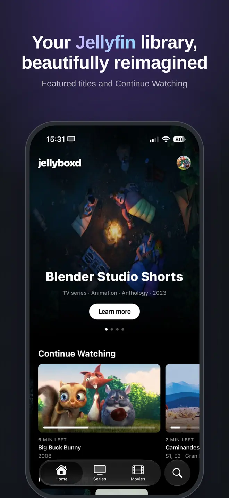
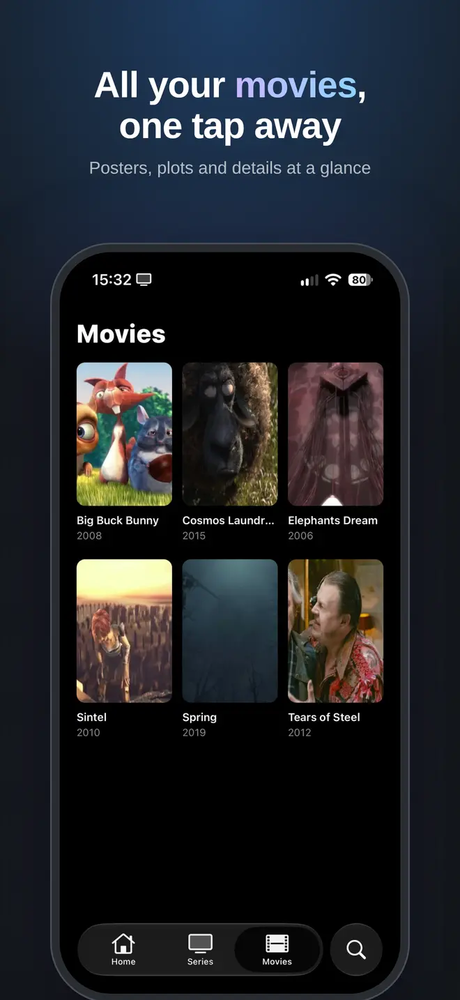
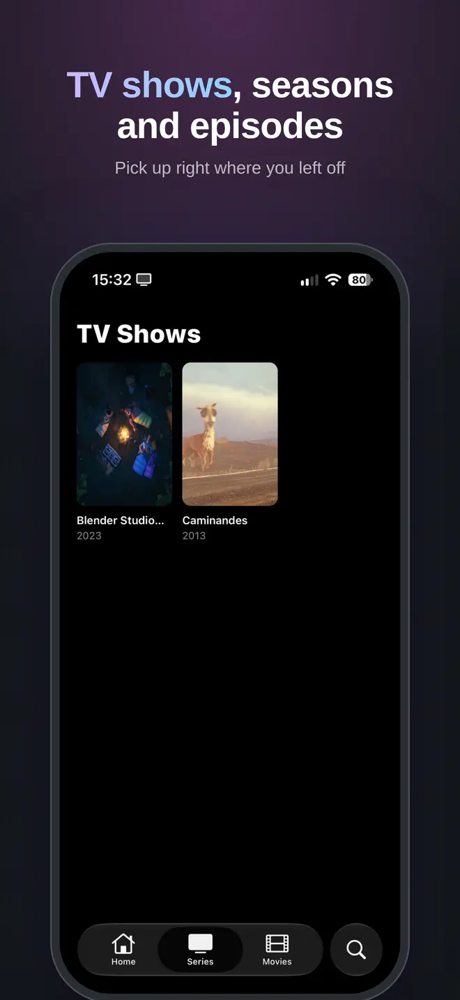
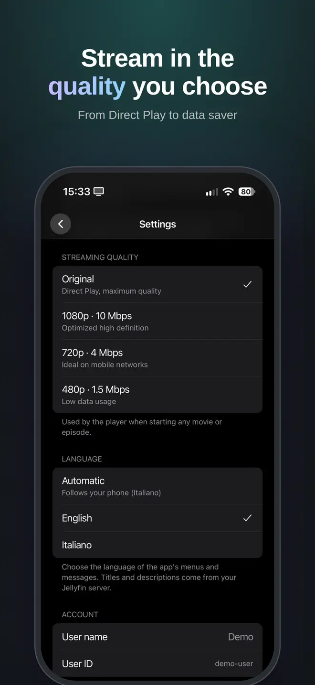

<p align="center">
  
</p>

<h1 align="center">Jellyboxd</h1>

<p align="center">
  A Jellyfin client for iPhone that tries to feel like a proper streaming app.
</p>

<p align="center">
  <a href="https://apps.apple.com/app/id6816114676"></a>
</p>

<p align="center">
  
  
  
  
</p>

I run Jellyfin at home and wanted something on my phone that looked closer to the big streaming apps: large artwork, a featured carousel, a "continue watching" row, and video that plays in the system player. That's what Jellyboxd is. It's small on purpose and only does the things I actually use.

## What it does

- Home with featured titles, Continue Watching and your latest additions
- Movies and TV shows, down to seasons and episodes
- Search across the whole library
- Native iOS player: Picture in Picture, background audio, AirPlay
- Subtitles: text tracks show up in the player's subtitle menu, image-based ones (PGS, VobSub) get burned in by the server
- Streaming quality setting, from Direct Play to lower bitrates when you're on mobile data
- Several servers and users, with custom names, and quick switching between them
- Favorites and watched state, synced with the server
- English and Italian

There's no account, no analytics and no tracking. Your server address and token are kept in the iOS Keychain and the app only talks to your server.

## Requirements

- iPhone with iOS 16.4 or later
- A Jellyfin server you can reach from the phone (LAN, VPN or a public domain, `http` or `https`)

## Building it yourself

The app is built with Expo (SDK 57) and Expo Router. You'll need [Bun](https://bun.sh), a Mac with Xcode, and an iPhone or simulator.

```sh
git clone https://github.com/matthewhalf/jellyboxd.git
cd jellyboxd
bun install
bunx expo run:ios
```

It uses native modules (`expo-video`, `expo-glass-effect`, ...), so Expo Go won't work: `expo run:ios` builds a development client instead.

Other useful commands:

```sh
bun run lint
bunx tsc --noEmit
bun test        # runs jest
```

The `.github/workflows/build-ios.yml` workflow builds an unsigned `.ipa` when you push a `v*` tag, if you want to sideload it.

### Project layout

```
src/app/         screens (Expo Router, one file per route)
src/components/  UI pieces: hero carousel, shelves, cards
src/context/     auth/servers and the native player
src/services/    Jellyfin API wrapper and server URL handling
src/i18n/        translations and language switching
locales/         localized iOS system strings
```

## Contributing

Bug reports and pull requests are welcome. If you're planning something bigger, open an issue first so we can talk about it.

Translations are probably the easiest way to help: add a file next to `src/i18n/en.ts` and `locales/en.json`.

Jellyboxd is also published on the App Store. By opening a pull request you agree that your contribution can be distributed there as part of the app.

## License

[GPL-3.0](LICENSE). The name "Jellyboxd" and the app icon aren't covered by the license, so if you publish a fork, please give it a different name and icon.

The images in `assets/demo/` are frames from the Blender Foundation open movies (Big Buck Bunny, Sintel, Spring and others), released under Creative Commons Attribution licenses. Full credits are in `src/services/demo/attribution.ts`.

Jellyboxd is an independent project and isn't affiliated with or endorsed by the Jellyfin project.
